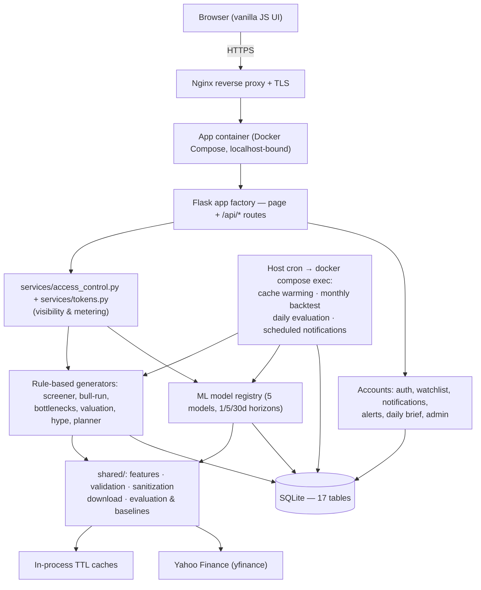

# RYCHEZT — Stock Analysis, Screening & Allocation Platform

A Flask web application that pairs a machine-learning multi-horizon return forecaster with a set of transparent, rule-based analysis engines — a tiered stock screener, a fair-value/exit-discipline engine, a hype filter, a sector-bottleneck scanner and a Canadian-tax-aware capital-allocation planner — behind a full account layer with tiered access, token metering, and a scheduled forward-testing backtest harness.

**Live app:** [rychezt.com](https://rychezt.com)

> **Note:** This is a public showcase repository documenting the architecture and engineering decisions. The application source is private (see [Status](#status)).

<!-- SCREENSHOTS: add 3–5 screenshots here (Analyze/forecast, Discover/tiered gainers, Portfolio/planner basket, accuracy scoreboard) -->

---

## What it is

The platform contains **three layers** that are intentionally kept separate in the codebase. They are easy to conflate, so to be precise:

**1. The multi-horizon return forecaster — this is the ML.**
Per-ticker XGBoost regressors that predict a stock's forward return at a **selectable horizon of 1, 5, or 30 trading days**. When a user requests a forecast for a symbol, a model is trained on that symbol's own price history and used to produce the prediction. Five models are registered; four of them train an XGBoost regressor and one is an ensemble wrapper. This is the only machine-learning component.

**2. The screeners, valuation and planning engines — these are NOT ML.**
The Free, Premium and Pro recommendation lists, the Valuation Check, the Exit Discipline signals, the Hype Check, the Sector Bottleneck Scanner and the Capital-Allocation Planner are all produced by **deterministic, rule-based scoring** — no learned model anywhere in that path. They combine fundamental, technical and (for the Free tier) news-sentiment signals into transparent point scores, and every result carries human-readable reasons explaining *why* it scored as it did. A reader should not assume these surfaces are "AI-driven"; they are explainable heuristic engines.

**3. The account and entitlement layer.**
User accounts with guest fallback, a monthly token wallet metering the paid surfaces, tier-based access control, a per-account watchlist with edge-triggered alerts and a daily digest, and a hidden admin console with read-only analytics.

The layers share infrastructure (data download, caching, the ticker universe) but are independent: the screener does not call the ML models to rank stocks, the forecaster does not depend on the screener, and **generation never decides visibility** — recommendation generators only *tag* their output with a tier, and `services/access_control.py` is the single place that decides who can see what.

---

## Product surface

Everything lives under **three destinations**, each with URL-addressable sub-views:

| Destination | Intent | Sub-views |
|---|---|---|
| **Analyze** (`/`) | "I have a ticker in mind." | **Forecast** (multi-horizon model comparison), **Fair value** (valuation gauge + exit discipline + Hype Check), **History** (per-model track record) |
| **Discover** (`/discover`) | "Find me something new." | **Basics** (beginner index shelf), **Gainers** (Free/Premium/Pro tiered screener), **Bottlenecks** (sector constraint scanner) |
| **Portfolio** (`/portfolio`) | "My money." | **Holdings** (watchlist, alerts, daily brief), **Plan** (Capital-Allocation Planner) |

Plus `/learn` (plain-English glossary), `/account`, `/pricing`, and a hidden `/admin` console with `/admin/analytics`. Retired URLs (`/predictions`, `/valuation`, `/recommendations`, `/watchlist`, `/planner`) 302-redirect to their new homes so old links keep working.

### Feature map

- **Multi-horizon forecasting** — Next day (1) / Next week (5) / Next month (30, default) trading days, driven by one config tuple that feeds route validation, the backtest loop and every UI selector. One click runs the model comparison at the selected horizon; the 1-day view carries an explicit "shorter horizons are noisier" caveat.
- **Company-name search** — every ticker field accepts a company name with live autocomplete, resolved by an instant offline index first and Yahoo's symbol search only as a fallback.
- **Tiered screener (Likely Gainers)** — Free rule-based value+quality screen over a curated ~150-ticker large-cap universe; Premium pre-breakout and confirmed-breakout scans over an expanded ~1,000-ticker discovery universe; Pro reserved for smart-money signals that have no generators yet.
- **Sector Bottleneck Scanner** — 27 curated bottleneck definitions across 5 sectors (AI infrastructure, energy/utilities, healthcare, fintech, cybersecurity), scoring how directly a company is tied to a structural constraint.
- **Valuation Check + Exit Discipline** — blended DCF / comparable-multiple / historical-multiple fair value with adaptive method weighting, cached 12 hours, feeding conservative exit signals (Hold → Watch Carefully → Do Not Chase → Trim → Exit Most).
- **Hype Check (Premium)** — a second layer on the valuation result that asks whether a premium is *earned by fundamentals or pure hype*, scored across five sector-adaptive pillars with a loud abstention when data coverage is too thin.
- **Watchlist** — per-account holdings with conviction, entry price/date, status, and an automatic fair-value snapshot at add time; per-row on-demand analysis composed from signals the app already computes.
- **Alerts & daily brief** — an in-app notification inbox with a per-user master toggle and unread-dedupe; edge-triggered valuation alerts fire once per transition; a once-per-UTC-day portfolio digest assembles only genuinely notable holdings.
- **Capital-Allocation Planner** — a deterministic, Canadian-tax-aware waterfall (emergency cash → high-interest debt → employer RRSP match → FHSA → TFSA → RRSP → taxable) using 2026 CRA figures, plus a Premium-gated personalized basket that *sizes* existing screener output rather than generating new picks.
- **Token metering** — a monthly wallet (Free 25, Premium 500, Pro/admin unlimited) with a 3-token guest wallet for forecasts, per-stock charge deduplication, and a reveal cap so a passive page view can't drain a Free member's grant.
- **Admin console** — user/tier management, token grants, an audit log, a resolved-prediction log with per-horizon filtering, and a read-only analytics dashboard that never mutates state (notably, it never triggers the lazy monthly token reset).

---

## Architecture

The application follows a layered separation:

- **Presentation** — server-rendered Jinja templates with vanilla JavaScript; no SPA framework. Two self-hosted webfonts, IIFE-scoped and root-guarded feature scripts, and a small set of `window.*` bootstrap globals emitted once per template.
- **Application / routing** — a Flask app factory exposing ~64 routes in total: page routes, a `/predict` endpoint, and ~42 `/api/*` JSON endpoints.
- **Service layer** — business logic split by responsibility across ~30 modules: the ML model registry, the rule-based recommendation engine, the premium breakout/pre-breakout scanner, valuation and downside risk, the hype filter, news sentiment, public trade activity, the allocation planner, tokens, access control, notifications, auth, and admin analytics. Recommendation *generation* is deliberately kept separate from *tier/access-control* logic.
- **Shared infrastructure** — reusable feature engineering, data download with validation/sanitization, shared evaluation/baseline math, and centralized configuration constants used across every model.
- **Data access** — a SQLite layer (schema, migrations, and cache tables) fronting 17 tables.

### Data stores

- **SQLite** as the primary store: user accounts, preferences, token wallets and ledger, watchlists, saved allocation plans and their snapshots, notifications and valuation alerts, stored predictions and their realized outcomes, an admin audit log, plus cache tables for fundamentals, news analysis, price history, valuation and recommendation payloads.
- **In-process TTL caches** for hot paths: a short-lived price-history download cache keyed on `(ticker, start, end)` — so multiple models in one request, or a cron run, hit the data provider once — and longer-lived recommendation/premium caches with stale-fallback behavior.

### External integrations

- **Yahoo Finance (via `yfinance`)** is the single external data source — OHLCV price history, company fundamentals, news headlines, symbol search, and insider/executive transaction data. The data layer is hardened against Yahoo's intermittent `401/429/5xx` responses, falling back to stale cached rows rather than failing a whole run.

> Politician/congressional trade data is **not** wired up. The bucket exists in `services/public_trade_activity.py` as a documented placeholder that always reports `"unavailable"` and contributes zero to the combined score; a real provider can be slotted in without touching the models that consume it.

### Deployment

Production runs on a **DigitalOcean Ubuntu droplet**. **Docker Compose** builds and runs the application container bound to localhost, with the SQLite file and log directory bind-mounted so warm-up scripts executed inside the container write the same database the web process reads across restarts. **Nginx** sits in front as the reverse proxy handling public traffic, TLS (Certbot / Let's Encrypt) and static files. **Host cron** drives the scheduled jobs by shelling into the running container (`docker compose exec -T financial-model …`).

A **native deployment path** — Gunicorn on `127.0.0.1:8000` supervised by systemd behind the same Nginx layer — is fully documented in `DEPLOYMENT.md` as the non-containerized alternative. Note that `gunicorn` is installed as part of *that* path's setup and is not pinned in `requirements.txt`.

### High-level request flow

---

## Technical highlights

Each item below is framed as **problem → approach → result**.

**Concurrent data fetching.**
*Problem:* scoring a list of stocks means many independent, latency-bound calls to Yahoo Finance, which is slow done sequentially.
*Approach:* fetches and per-ticker news analysis run on a `ThreadPoolExecutor` with up to **8 worker threads**, using `as_completed` so a single slow or failing ticker never blocks or aborts the batch. Background cache refreshes use a separate single-worker executor so they can't contend with live requests.
*Result:* wall-clock time for a multi-ticker screen is bounded by the slowest few concurrent calls rather than the sum of all calls. (Deliberately qualitative — no speedup factor has been benchmarked, so none is claimed.)

**Forward-testing backtest harness.**
*Problem:* in-sample metrics on a held-out tail don't tell you whether predictions hold up in the real future.
*Approach:* a scheduled monthly job runs **every registered model** over the **top 50 current recommendations** at **every configured horizon** and stores each prediction — up to **750 rows per batch** (50 × 5 models × 3 horizons). A separate daily evaluation job fetches the *realized* close once each row's own horizon has elapsed and records the actual return, direction correctness, and prediction error. Batch IDs are deterministic (`recommendations_2026_07`) and rows are keyed on `(batch_id, ticker, model_name, forecast_horizon_days)`, so re-running a month is idempotent.
*Result:* a growing record of genuine out-of-sample outcomes, broken out per model **and** per horizon — the scoreboard never blends horizons into a single misleading number.

**Trading-day-exact evaluation.**
*Problem:* the training target is `Close.shift(-h)`, which counts *trading rows*. Scoring a prediction N *calendar* days later silently measures something different from what the model was fit to.
*Approach:* evaluation resolves each row at the close exactly N trading rows after the prediction date, via an exact weekday walk that counts rows strictly after the prediction date (immune to a missing prediction-day bar). The due gate is held one extra day so the target session's bar is final, prices are fetched with `auto_adjust=True` to match the training price basis, the index is timezone-normalized, downloads are memoised per `(ticker, date)` per run, and a shared `HOLIDAY_GRACE_DAYS` constant keeps the evaluator's quiet-wait window and the admin "overdue" KPI from ever drifting apart.
*Result:* reported accuracy measures the same quantity the model was trained on, and a live intraday price can never be locked in as a realized outcome.

**Generation separated from entitlement.**
*Problem:* tier checks scattered through routes, templates and cron scripts are the classic way an access-control system rots — and the fastest way to leak a paid row to a free viewer.
*Approach:* generators only *tag* output with a tier. A single `TIER_VISIBILITY` mapping in `services/access_control.py` defines the superset relationships (`pro ⊃ premium ⊃ free`), and every route funnels through it. Unentitled viewers of the Premium list receive a showcase payload — an aggregate card plus one rotated free pick — and **the locked rows are never sent to the client**. Each gate has a one-line enforcement flag so behavior can be flipped without touching route code.
*Result:* when billing lands, entitlement changes in one file rather than across templates, scripts and cron.

**Cache warming.**
*Problem:* generating recommendation tiers on a cold cache is expensive, so the first user after expiry would wait.
*Approach:* cron-driven warm-up scripts pre-compute and store the Free, Premium, bottleneck and hype payloads on a market-hours-aware cadence; **warm keys are constructed to match the keys the live routes read**, and that parity is locked by tests. A failed refresh records its error without overwriting a previously usable payload.
*Result:* user requests are typically served from a warm cache; stale-fallback keeps the UI responsive during data-provider outages.

**Resilience to a flaky upstream.**
*Problem:* Yahoo's public endpoints intermittently return `401/429/5xx`.
*Approach:* a shared retry helper with exponential backoff that re-raises non-transient errors immediately (so genuine bugs are never masked), a short-TTL in-process download cache, stale-cache fallback in the data layer, a bad-ticker cooldown, and a scanner time budget that returns partial results rather than hanging. The monthly backtest classifies failures as **data-fetch** vs **model** failures and reports them separately, so a Yahoo outage is never mistaken for a model regression.
*Result:* the screener and backtest remain usable through brief provider outages, and one bad ticker never aborts a batch.

**Per-request model training (a deliberate design choice).**
*Problem:* a meaningful forecast needs a model fit to the specific ticker's history; there is no shared cross-sectional model.
*Approach:* rather than persisting model artifacts, each forecast request downloads fresh history, engineers features, trains the regressor on that ticker, evaluates on a held-out chronological tail, and predicts the latest row. Input price data is cached briefly to amortize repeated calls.
*Result:* always-current forecasts with no stale model artifacts to manage — at the cost of compute per request, which is an explicit and documented trade-off.

---

## Machine learning approach

This section describes the forecaster (layer #1). It is written to be honest about both what is implemented and what the results actually show.

**The model registry.** Five models are registered behind one dispatch table, so adding a sixth is a single-line change and the cron/backtest picks it up automatically:

| Model | What it is |
|---|---|
| **Model 1** | Original technical-only XGBoost regressor. Kept registered for rollback and A/B comparison. |
| **Model 1.1** | Production-safe evolution of Model 1 — same 18-feature philosophy, composed from the hardened `shared/` pipeline (zero-safe denominators, upfront data validation, early stopping, pre-train finite checks). A default column on the forecast page. |
| **Model 2** | Legacy market-aware model — stock technicals plus S&P 500 ETF and volatility-index context. |
| **Model 2.1** | Production-safe market-aware model. Same 29-feature design as Model 2, built on the `shared/` pipeline. A default column on the forecast page. |
| **Model 3** | An **ensemble wrapper, not a newly trained regressor**: `0.45 × Model 1.1 + 0.55 × Model 2.1`, plus a news-sentiment adjustment capped at ±2 pp and a public-trade-activity adjustment capped at ±2 pp, with the combined external influence capped at ±3 pp so the quantitative base always dominates. |

**The prediction target.** A single regression target: a stock's forward return over the selected horizon, where the horizon counts **trading days** (`Close.shift(-h)`). Direction (bullish/bearish/neutral) and an estimated price are derived from the predicted return for display.

**Feature engineering.** Features are genuinely engineered from raw OHLCV data — not raw closing prices fed directly to the model. The base models use **18 technical indicators** spanning several categories:

- lagged price returns over multiple lookbacks,
- moving-average ratios across several windows,
- rolling realized volatility,
- volume dynamics,
- intraday price spreads,
- price momentum,
- a relative-strength oscillator.

The market-aware variants extend this with broad-market context derived from a market-index ETF (5 features) and a volatility index (4 features), plus 2 stock-versus-market interaction features, for **29 features** total. (Exact formulas are omitted here intentionally; this repo documents categories, not the implementation.) Feature computation includes explicit guards against zero-denominator and non-finite values, and the feature matrix is validated before it reaches the model.

**Data gating.** Minimum history (~2 years of trading days), liquidity (rolling 30-day average volume floor), a zero-volume-day ratio ceiling, and a minimum price are all enforced *before* a model is trained at all. Tickers that fail raise an actionable error rather than producing a garbage forecast.

**The model.** An **XGBoost gradient-boosted-tree regressor**. Hyperparameters are a **fixed, hand-set configuration** (300 estimators, depth 4, learning rate 0.05, 0.9 subsample/colsample). They are **not** tuned via grid/random search or cross-validation — this is a known, deliberate "good defaults for now" state and the most obvious remaining improvement. The `.1` variants add early stopping against a small chronological validation slice carved from the end of the training data.

**Train/test split and embargo.** The split is **chronological**, not a random shuffle: the earliest ~80% of each ticker's samples train, the most recent ~20% are held out. Because the target is a forward return, the labels of the last training rows would otherwise be computed from prices falling inside the test window — so a **horizon-sized embargo** drops the boundary rows entirely (they enter neither set). The embargo tracks the *requested* horizon rather than a fixed constant, so a 1-day forecast doesn't needlessly discard 29 test rows.

**Naive baselines.** Every evaluation scores three deliberately dumb reference forecasts on the *identical* test set through the *identical* metric code:

- **predict-zero** — the "no drift" forecast,
- **predict-last-value** — persistence; the most recent *already-realised* horizon return, computed purely from past closes so it stays leakage-free,
- **predict-train-mean** — average historical drift.

Alongside them, a **positive base rate** reports what fraction of test rows actually rose — the chance-level reference for direction accuracy, so a model that simply always guesses "up" can't masquerade as skilful. All of it surfaces additively in the API response and as a collapsible comparison table in the UI.

**Honest results.** Predicting equity returns from technical features is genuinely hard, and the measured results say so plainly. On the tickers evaluated after the embargo landed, the models **roughly match or lose to the naive baselines**: R² sits near zero or negative, and direction accuracy tends to track the positive base rate rather than beat it. On at least one tested name, predict-last-value was the better forecaster on every error metric.

That result is published rather than buried, because the engineering value here is a clean, validated, leakage-aware pipeline plus a real forward-testing harness that is *capable of showing the model losing* — not a claim of market-beating accuracy. A pipeline that can only ever flatter its model isn't measuring anything.

**What's still open.** The 1-day and 5-day horizons are new; their predictive value is unproven by design, and the per-horizon scoreboard plus baselines exist precisely to measure it honestly as production evaluations accumulate. Hyperparameter tuning, richer features, and a different target formulation are the natural next steps.

---

## Tech stack

- **Language:** Python
- **Web framework:** Flask (app-factory pattern), server-rendered Jinja templates + vanilla JavaScript frontend
- **Data / ML:** XGBoost, scikit-learn (metrics), pandas, NumPy
- **Market data:** yfinance (Yahoo Finance)
- **Datastore:** SQLite
- **Concurrency:** `concurrent.futures.ThreadPoolExecutor`
- **Server / infra:** Docker / Docker Compose, Nginx, Certbot/Let's Encrypt for TLS, DigitalOcean (Ubuntu). Gunicorn + systemd are used by the documented alternative native deployment path.
- **Scheduling:** host cron (cache warming, monthly backtest, daily evaluation, scheduled notifications)
- **Testing:** pytest — **1,305 tests passing** across 33 test modules

Runtime dependencies are deliberately minimal: Flask, NumPy, pandas, scikit-learn, XGBoost and yfinance. No Redis, no Celery, no external queue, no paid data provider, no API keys.

---

## Engineering practice

A few conventions the codebase holds itself to, since they shaped most of the design decisions above:

- **Cache warm keys must equal read keys**, enforced by parity tests — a warm/read key mismatch is this project's most expensive class of bug.
- **Tier behavior stays centralized.** When one tier gains a behavior, the others follow the same shared helper; diverging tier logic is the most common source of regressions here.
- **Backend logic changes ship with tests.** New behavior is written test-first, and the full suite is expected green before work is called done.
- **Every session is logged.** A structured engineering log records what was inspected, what changed, what was verified, and — importantly — **what was *not* tested**, so the next session starts from an honest picture rather than an optimistic one.

---

## Status

The application source is **private** while the project is being developed into a product; it is currently in private beta. This repository documents the architecture and engineering decisions only. A full walkthrough or demo is available on request.
