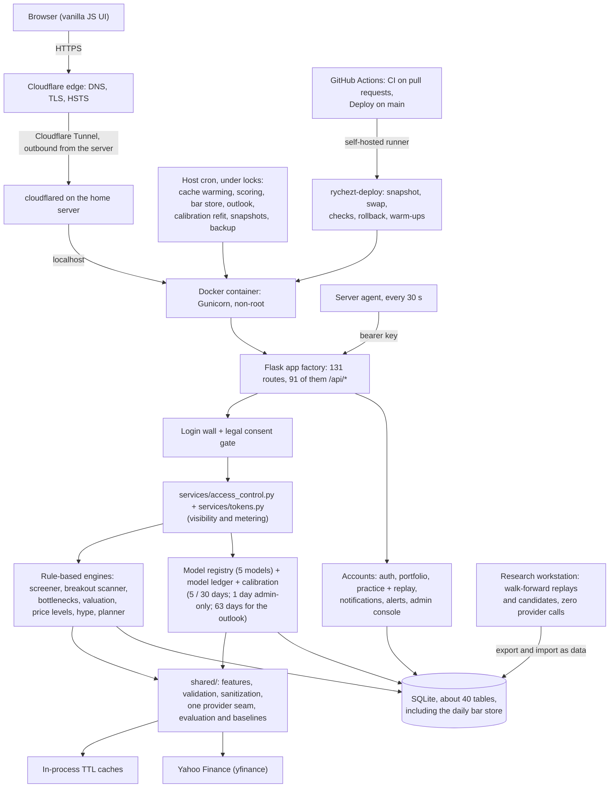

# RYCHEZT: Stock Analysis, Screening and Allocation Platform

A Flask web application that pairs a machine-learning return forecaster with a set of transparent, rule-based analysis engines (a tiered stock screener, a fair-value and exit-discipline engine, a hype filter, a sector-bottleneck scanner, a price-level reader and a Canadian-tax-aware capital-allocation planner), behind a full account layer with tiered access, token metering, a practice portfolio, a legal-consent gate and an admin console. Beside the product sits a research harness: a daily bar store back to 2005 and a walk-forward replay system that has judged six rounds of forecasting ideas, with verdicts that are published here rather than buried.

**Live app:** [rychezt.com](https://rychezt.com)

> **Note:** This is a public showcase repository documenting the architecture and engineering decisions. The application source is private (see [Status](#status)). Last brought in line with the codebase on 2026-11-02.

<!-- SCREENSHOTS: add 3 to 5 screenshots here (Analyze stock page, Discover outlook, Practice portfolio, admin Benchmarks, admin Servers) -->

---

## What it is

The codebase keeps **four layers** deliberately separate. They are easy to conflate, so to be precise:

**1. The return forecaster: this is the ML.**
Per-ticker XGBoost regressors that predict a stock's forward return over a horizon counted in trading days. Members choose **5 or 30 trading days** on Analyze; a 1-day horizon still exists but is admin-only (too noisy to show), and a **63-day (one quarter) horizon** drives the Quarterly outlook list on Discover. When a user requests a forecast, a model is trained on that symbol's own price history and used to produce the prediction. Five models are registered; four train an XGBoost regressor and one is an ensemble wrapper. A calibration layer sits on top of the live forecasts and decides whether a forecast is allowed to *claim* an edge at all (today, none does; see [Machine learning approach](#machine-learning-approach)).

**2. The screeners, valuation and planning engines: these are NOT ML.**
The Free, Premium and Pro recommendation lists, the Valuation Check, the Exit Discipline signals, the Hype Check, the Sector Bottleneck Scanner, the price levels and the Capital-Allocation Planner are all produced by **deterministic, rule-based scoring**, with no learned model anywhere in that path. They combine fundamental, technical and (for the Free tier) news-sentiment signals into transparent point scores, and every result carries human-readable reasons explaining *why* it scored as it did. A reader should not assume these surfaces are "AI-driven"; they are explainable heuristic engines. The one list a model does order is the Quarterly outlook, and it shows ranks only, never a forecast.

**3. The account and entitlement layer.**
User accounts behind a login wall, a monthly token wallet metering the paid surfaces, tier-based access control (Free, Premium and Pro, plus admin and tester roles and an Owner flag), per-account portfolios with edge-triggered alerts and a daily digest, a practice portfolio, a published privacy policy and terms with a consent gate, and a hidden admin console.

**4. The research harness: offline, on a workstation, zero live data calls.**
A daily bar store, a walk-forward replay harness, a candidate registry, a model ledger and a calibration refit. It evaluates the forecaster and its proposed successors on the same code the site runs, writes its results into their own tables (never the live prediction log), and moves between the workstation and the server as data.

The layers share infrastructure (data download, caching, the ticker universe) but are independent: the screener does not call the ML models to rank stocks, the forecaster does not depend on the screener, the harness never touches a live row, and **generation never decides visibility**. Recommendation generators only *tag* their output with a tier, and `services/access_control.py` is the single place that decides who can see what.

---

## Product surface

Everything lives under **three destinations**, each with URL-addressable sub-views:

| Destination | Intent | Sub-views |
|---|---|---|
| **Analyze** (`/`) | "I have a ticker in mind." | **Stock page**: one search runs the fair-value check and the forecast together under an at-a-glance card (*Where is it now? Where might it go? When would I act?*), with an Entry & exit section (the price levels, the pullback and breakout setups, the Exit Discipline panel), a "your position" line for members who hold the ticker, a buy-with-practice-money button and the ensemble's track record. **History**: the public per-model accuracy record |
| **Discover** (`/discover`) | "Find me something new." | **Basics** (beginner index shelf), **Gainers** (Free / Premium / Pro tiered screener as ranked score cards beside a filter rail), **Bottlenecks** (sector constraint scanner), **Outlook** (the large-cap universe ranked by a model's three-month forecast, ranks only) |
| **Portfolio** (`/portfolio`) | "My money." | **Holdings** (first-class accounts, the watchlist, alerts, a daily brief, CAD conversion), **Plan** (Capital-Allocation Planner), **Practice** (a simulated portfolio with a Replay mode) |

Plus `/learn` (plain-English glossary), `/account`, `/pricing`, `/privacy`, `/terms`, the welcome page (a self-playing tour), the consent page `/legal/accept`, and a hidden `/admin` console with Analytics, Users, Models, Benchmarks, Discover and Servers tabs. Retired URLs 302-redirect to their new homes so old links keep working.

**An account is required.** A visitor without one sees the welcome page at whatever URL they asked for (an HTTP 200, not a redirect, with the matching chapter of the tour in focus); only the welcome page, sign-in, sign-up, the two legal pages and an accuracy probe are public, and every other `/api/*` call from a guest answers 401. After signing in, a member lands on the page they asked for, after the consent page if a legal document changed since they last agreed.

### Feature map

- **Forecasting at a chosen horizon**: one click runs the model comparison at 5 or 30 trading days (1 day is admin-only), driven by one config tuple that feeds route validation, the backtest loop and every UI selector. Each live forecast that qualifies is recorded in a model ledger beside a snapshot of its features, so it can be scored later and audited.
- **Calibrated forecast lines**: a calibration layer fitted to the forecaster's own scored history decides, per model and horizon, whether a forecast may claim an edge (a margin clear of 1.96 standard errors) and what band to show. A version with no demonstrated edge serves no band and no claim.
- **Company-name search**: every ticker field accepts a company name with live autocomplete, resolved by an instant offline index first and the data provider's symbol search only as a fallback.
- **Tiered screener (Likely Gainers)**: a Free rule-based value and quality screen over a curated **149-ticker** large-cap universe; Premium pre-breakout and confirmed-breakout scans over an expanded **848-ticker** discovery universe; Pro reserved for smart-money signals that have no generators yet.
- **Token reveal on Discover**: the Free list stays free; Premium and bottleneck picks show to everyone as blind cards and reveal for one token on click. The blind row is a whitelist and a pick's identity is an HMAC slot resolved server-side, so **the locked picks are never sent to the client**.
- **Discover track record**: a daily snapshot of every list, scored later against realised outcomes and read against the list's own pool, so a reader can see whether the lists have been worth following.
- **Quarterly outlook**: the universe ranked by a model's 63-day forecast, the top fifth (about 30 names) in ranks only, with no forecast value at any depth; one scheduled writer, computed from the bar store with zero data-provider calls.
- **Sector Bottleneck Scanner**: 27 curated bottleneck definitions across 5 sectors (AI infrastructure, energy and utilities, healthcare, fintech, cybersecurity), scoring how directly a company is tied to a structural constraint.
- **Valuation Check + Exit Discipline**: blended DCF, comparable-multiple and historical-multiple fair value with adaptive method weighting, cached 12 hours, feeding conservative exit signals (Hold → Watch Carefully → Do Not Chase → Trim → Exit Most).
- **Price levels (Entry & exit)**: named rule levels on raw bars (the 50 and 200-day averages, the lowest and highest closes of the last 20, 60 and 252 sessions), each with its touch and break counts, read against the live quote as three floors and three ceilings plus a plan, and drawn as dashed lines on the price chart.
- **Hype Check (Premium)**: a second layer on the valuation result that asks whether a premium is *earned by fundamentals or pure hype*, scored across five sector-adaptive pillars with a loud abstention when data coverage is too thin.
- **Portfolio accounts, watchlist and alerts**: first-class accounts to open, rename and archive; holdings with conviction, entry price and date, a fair-value snapshot at add time and per-row on-demand analysis; an in-app notification inbox; edge-triggered valuation and trim alerts that fire once per transition; a once-per-day portfolio digest of only the genuinely notable holdings; honest currency math for CAD members.
- **Practice portfolio and Replay**: $10k of simulated money with instant fills at real delayed prices, a decision journal, a benchmark comparison and a behaviour report card (Free, un-metered, fully isolated from real holdings). Replay mode plays the 2020 crash, the 2022 rate shock, the 2008 crisis or a hidden random stretch one week per step, priced from a warmed weekly store, with no forecasts, valuation, news or recommendations visible inside the run.
- **Capital-Allocation Planner**: a deterministic, Canadian-tax-aware waterfall (emergency cash → high-interest debt → employer RRSP match → FHSA → TFSA → RRSP → taxable) using 2026 CRA figures, plus a Premium-gated personalized basket that *sizes* existing screener output rather than generating new picks.
- **Token metering**: a monthly wallet (Free 25, Premium 500, Pro and admin unlimited), per-stock charge deduplication, and a reveal cap so a passive page view can't drain a Free member's grant.
- **Account security**: one password rule set with a breach check against Have I Been Pwned (k-anonymity: only a hash prefix leaves the server), a login throttle that sees the real client address through the tunnel, a reset flow, CSRF protection on forms, and an Owner role that alone can delete accounts or change another admin's account.
- **Welcome tour**: four chapters and 18 scenes of invented sample data that play on their own beside the sign-up card, rendered from a pure, standard-library module and making no request to the app.
- **Admin console**: user and tier management, token grants, account deletion with a record per deleted account, an audit log, the model ledger with per-horizon filtering, a Benchmarks page reading the research harness's stored summaries, a Discover page over the track record, a Servers tab fed by a host agent, and a read-only analytics dashboard that never mutates state.

---

## Architecture

The application follows a layered separation:

- **Presentation**: server-rendered Jinja templates with vanilla JavaScript; no SPA framework. Light and dark themes, two self-hosted webfonts, IIFE-scoped and root-guarded feature scripts, and a small set of `window.*` bootstrap globals emitted once per template.
- **Application / routing**: a Flask app factory exposing **131 routes**: page routes, the `/predict` endpoint and **91 `/api/*` JSON endpoints** (17 of them under `/api/admin/`). One `before_request` gate is the login wall; its allowlist is a set of endpoint names, never paths, pinned by a test.
- **Service layer**: business logic split by responsibility across **63 modules**, many of them pure (frames or dicts in, dicts out, no I/O): the model registry, the rule-based recommendation engine, the breakout scanner, valuation and exit discipline, the price levels, the hype filter, news sentiment, the allocation planner, the practice portfolio and replay, tokens, access control, notifications, auth and the password rule set, the legal gate, the model ledger, the calibration, the walk-forward harness, the candidates, server monitoring, and the admin pages' read sides. Recommendation *generation* is deliberately kept separate from *tier / access-control* logic.
- **Shared infrastructure**: feature engineering, data download with validation and sanitization, one provider seam that every download goes through (an AST scan in the suite pins that nothing else calls the provider), shared evaluation and baseline math, and centralized configuration constants used across every model.
- **Data access**: a SQLite layer (schema, migrations and cache tables) fronting **about 40 tables**. A registry names every per-user table, children before parents, so a data export and an account deletion reach all of them; a parity test fails when a new table is missed.

### Data stores

- **SQLite** as the primary store (WAL mode): user accounts, preferences, token wallets and ledger, portfolio accounts and watchlists, saved allocation plans and their snapshots, practice accounts and transactions, replay runs, notifications and alerts, the prediction log with its feature side rows, the Discover snapshots and outcomes, the quarterly outlook, the daily bar store, the walk-forward replay batches, calibration versions, the admin audit log, account-deletion records, server metrics, plus cache tables for fundamentals, news analysis, price history, valuation and recommendation payloads.
- **The daily bar store**: raw bars plus dividend and split events for about 200 symbols (the universe plus sector and index ETFs) back to 2005, roughly a million rows, dividend-adjusted on read. One scheduled writer; everything else reads.
- **In-process TTL caches** for hot paths: a short-lived price-history download cache keyed on `(ticker, start, end)`, so multiple models in one request, or a cron run, hit the data provider once, and longer-lived recommendation and premium caches with stale-fallback behaviour.

### External integrations

- **Yahoo Finance (via `yfinance`)** is the single market-data source: OHLCV price history, company fundamentals, news headlines, symbol search and insider transaction data. Every download goes through one seam (`shared/yahoo.py`), the data layer is hardened against the provider's intermittent `401/429/5xx` responses (falling back to stale cached rows rather than failing a run), and one host-level lock serialises every scheduled job that talks to the provider so two jobs never hit it at once.
- **Have I Been Pwned** range lookups check new passwords against known breaches without the password, or its full hash, ever leaving the server.
- **Cloudflare** fronts the site: DNS, the TLS certificate, HSTS and the tunnel described below. Cloudflare Email Routing serves the privacy contact mailbox.

> Politician and congressional trade data is **not** wired up. The bucket exists as a documented placeholder that always reports `"unavailable"` and contributes zero to the combined score; a real provider can be slotted in without touching the models that consume it.

### Deployment

Production moved in October 2026 from a cloud droplet to **a small home server**, and the shape changed with it:

- **No open ports.** A **Cloudflare Tunnel** connector on the server dials out to Cloudflare; nothing dials in, the home network needs no port forwarding, and the home's public address is never published. Cloudflare terminates HTTPS and sends HSTS, so there is **no Nginx and no certificate on the server**.
- **Gunicorn in Docker.** The container runs `python:3.11-slim` as a fixed-uid non-root user, Gunicorn with two gthread workers of four threads (the settings live in an importable `gunicorn.conf.py` so the tests assert them), bound to localhost only, with a SQLite-backed health check and bounded JSON logs. The database lives in a directory bind mount so SQLite's WAL side files survive a container swap. `requirements.txt` pins the app's direct dependencies and `constraints.txt` pins every package the image runs, transitive ones too; a dependency upgrade is an edit, never a side effect of a build.
- **Host cron** drives the scheduled jobs by exec-ing into the running container: cache warming on a market-hours-aware cadence, prediction scoring, the daily bar store, the quarterly outlook, the weekly calibration refit, the monthly champion extension, the Discover snapshot, the backtest and the nightly backup. Jobs that talk to the data provider take the provider lock; jobs that only touch the container take a shared container lock, so a deploy never recreates the container in the middle of one.
- **Backups and monitoring.** A nightly encrypted (`gpg`) copy of the database goes off-site to object storage (30 days there, 14 locally), and a dead-man's-switch monitor (healthchecks.io) pages when the backup or the site goes quiet. A standard-library **server agent**, installed as its own unprivileged user with no write access, reads `/proc`, the disks and the hardware sensors every 30 s and POSTs one report to the app with a bearer key; the admin Servers tab shows each machine as online, stale or offline with 1h / 24h / 7d charts, and a new server registers itself on its first report.

### Continuous deployment

Anything merged into `main` deploys itself:

1. **CI** runs the full pytest suite on a GitHub-hosted `ubuntu-24.04` runner (Python 3.11, installed against the constraints file) for every pull request into `main`.
2. **Deploy** runs on a push to `main`: the suite again, then a **self-hosted GitHub Actions runner on the server** runs one line, `sudo -n rychezt-deploy deploy <sha>`. The runner checks nothing out and holds no secret; its user is in neither `docker` nor `sudo` and has exactly one sudo rule, for a root-installed copy of the repo's deploy tool. A workflow can only *ask* for a deploy; what a deploy does is fixed by that tool.
3. **The deploy tool** (standard library only, four seams, its own test module) checks preconditions, builds the image, waits for the provider and container locks and for an idle container (it waits, never kills), **snapshots the database**, swaps the container, runs smoke checks (a 3xx on a public page counts as a failed release, which is why the login wall answers 200), **rolls back to the previous image by itself** when a check fails, and then runs the warm-ups. Distinct exit codes tell the workflow log what happened.
4. A repository variable pauses deploys before a merge that needs a manual step, docs-only pushes start nothing, and a burst of merges collapses to the newest pending run without ever cancelling a running deploy.

Every batch manifest and model-data transfer file carries the tree's version stamp (the git short sha, or the `CODE_VERSION` file the deploy writes because the container has no `.git`), and the import tool refuses foreign code unless told otherwise.

### High-level request flow

---

## Technical highlights

Each item below is framed as **problem → approach → result**.

**Concurrent data fetching.**
*Problem:* scoring a list of stocks means many independent, latency-bound calls to the data provider, which is slow done sequentially.
*Approach:* fetches and per-ticker news analysis run on a `ThreadPoolExecutor` with up to **8 worker threads**, using `as_completed` so a single slow or failing ticker never blocks or aborts the batch. Background cache refreshes use a separate single-worker executor so they can't contend with live requests.
*Result:* wall-clock time for a multi-ticker screen is bounded by the slowest few concurrent calls rather than the sum of all calls. (Deliberately qualitative: no speedup factor has been benchmarked, so none is claimed.)

**A walk-forward harness that can show the model losing.**
*Problem:* in-sample metrics on a held-out tail don't tell you whether a forecasting idea holds up, and a harness that can only flatter its model isn't measuring anything.
*Approach:* the unchanged production models, and every proposed successor, are replayed over the bar store on an as-of grid, on a separate workstation with zero live data calls. Each entry is scored against always-up, persistence and beat-flat baselines, against SPY (the call scored as "beats the market"), and as a *ranking*: per as-of date the tickers ordered by forecast and scored by realised excess return (the quintile spread, the Spearman IC, the top quintile against the date's base rate, a momentum ranking as the baseline). Uncertainty comes from a **block bootstrap over dates**, because forecasts on neighbouring days are not independent samples. A promotion report compares a candidate with the champion on the same grid, and a paired comparison reads one group's ranking against another's on the tickers both forecast. The OpenMP thread count is part of a batch's identity (XGBoost's results depend on it), every manifest carries the code version, and a reproduction check confirms that a replay reproduces its rows exactly.
*Result:* six rounds of ideas have been judged on evidence rather than enthusiasm, and the verdicts (below) are mostly "not shown". Promotion is a code change the maintainer approves from the report; nothing promotes itself.

**Trading-day-exact evaluation.**
*Problem:* the training target is `Close.shift(-h)`, which counts *trading rows*. Scoring a prediction N *calendar* days later silently measures something different from what the model was fit to.
*Approach:* evaluation resolves each row at the close exactly N trading rows after the prediction date, via an exact weekday walk that counts rows strictly after the prediction date (immune to a missing prediction-day bar). The due gate is held one extra day so the target session's bar is final. Realised prices are read on the **unadjusted** basis the stored start price was quoted on, with a split factor multiplied back for any split dated after the forecast, and SPY's return over the same window is stored beside each row so the live log and the harness grade on one definition.
*Result:* reported accuracy measures the same quantity the model was trained on, the start price and the realised close are on one basis, and a live intraday price can never be locked in as a realized outcome.

**Calibration that refuses to claim an edge.**
*Problem:* a forecast line on a product page implies skill whether or not the model has any.
*Approach:* a weekly refit bins the predicted move at weighted quintiles over the model's own scored history (live rows at full weight, the newest replay batch at half), measures each bin's lead over the better constant call with a standard error clustered by as-of date, and applies guardrails (a minimum of weighted rows and distinct dates). One rule, `claims_edge` (the margin clear of 1.96 standard errors), decides both the stored verdict and the label on the page. The first version for each model and horizon is activated by an admin and audited; later ones may activate themselves only when they pass.
*Result:* every active calibration today is `no_edge`, so the Analyze line serves no band and makes no claim. The machinery to say otherwise exists and waits for evidence.

**Generation separated from entitlement.**
*Problem:* tier checks scattered through routes, templates and cron scripts are the classic way an access-control system rots, and the fastest way to leak a paid row to a free viewer.
*Approach:* generators only *tag* output with a tier. A single `TIER_VISIBILITY` mapping defines the superset relationships (`pro ⊃ premium ⊃ free`), and every route funnels through it. Discover's blind cards go further: a locked pick is represented by an HMAC slot and revealed server-side for a token, so the payload a Free member receives never contains it. Each gate has a one-line enforcement flag so behaviour can be flipped without touching route code.
*Result:* when billing lands, entitlement changes in one file rather than across templates, scripts and cron.

**A login wall that is a 200, not a redirect.**
*Problem:* an account is now required, but a redirect to `/login` breaks deep links and, since the deploy tool's smoke checks count any 3xx on a public page as a failed release, would also break deploys.
*Approach:* one `before_request` gate shows a guest the welcome page *at the URL they asked for*, with the matching chapter of the tour in focus, and answers 401 on every non-public API route. The allowlist is a set of endpoint names (never path prefixes), so a new public route has to be added on purpose and the test suite notices when one isn't. The tour itself is 18 scenes of invented data rendered from a pure module, so a guest's visit makes no request and costs no token.
*Result:* old links keep working for guests and members alike, the smoke checks stay meaningful, and the entire pre-sign-up experience is static.

**Cache warming.**
*Problem:* generating recommendation tiers on a cold cache is expensive, so the first user after expiry would wait.
*Approach:* cron-driven warm-up scripts pre-compute and store the Free, Premium, bottleneck and hype payloads on a market-hours-aware cadence; **warm keys are constructed to match the keys the live routes read**, and that parity is locked by tests. A failed refresh records its error without overwriting a previously usable payload.
*Result:* user requests are typically served from a warm cache; stale-fallback keeps the UI responsive during data-provider outages.

**Resilience to a flaky upstream.**
*Problem:* the provider's public endpoints intermittently return `401/429/5xx`, and two of the app's own jobs hitting it at once was enough to get the old droplet rate-limited.
*Approach:* a shared retry helper with exponential backoff that re-raises non-transient errors immediately (so genuine bugs are never masked), a short-TTL in-process download cache, stale-cache fallback in the data layer, a bad-ticker cooldown, a scanner time budget that returns partial results rather than hanging, and one host-level lock that every provider-facing job takes. The backtest classifies failures as **data-fetch** vs **model** failures and reports them separately, so a provider outage is never mistaken for a model regression.
*Result:* the screener and the scheduled jobs remain usable through brief provider outages, and one bad ticker never aborts a batch.

**Deploys that roll themselves back.**
*Problem:* a one-person project with no staging environment ships straight to production, and a bad release at midnight has nobody watching.
*Approach:* the deploy tool snapshots the database before every swap, runs smoke checks against the new container, and retags and restarts the previous image on its own when a check fails. It never kills a running scheduled job: it takes the same locks the cron jobs take and waits for an idle container. The runner that triggers it is unprivileged, holds no secret and can only invoke that one root-installed script.
*Result:* a merge into `main` either lands verified or reverts itself, and nothing on the deploy path can reach the server from outside.

**Per-request model training (a deliberate design choice).**
*Problem:* a meaningful forecast needs a model fit to the specific ticker's history; there is no shared cross-sectional model in production.
*Approach:* rather than persisting model artifacts, each forecast request downloads fresh history, engineers features, trains the regressor on that ticker, evaluates on a held-out chronological tail, and predicts the latest row. Input price data is cached briefly to amortize repeated calls.
*Result:* always-current forecasts with no stale model artifacts to manage, at the cost of compute per request, which is an explicit and documented trade-off.

---

## Machine learning approach

This section describes the forecaster (layer #1) and the harness that judges it (layer #4). It is written to be honest about both what is implemented and what the results actually show.

**The model registry.** Five models are registered behind one dispatch table, so adding a sixth is a single-line change and the cron, the backtest and the harness pick it up automatically:

| Model | What it is |
|---|---|
| **Model 1** | Original technical-only XGBoost regressor. Kept registered for rollback and A/B comparison. |
| **Model 1.1** | Production-safe evolution of Model 1: same 18-feature philosophy, composed from the hardened `shared/` pipeline (zero-safe denominators, upfront data validation, early stopping, pre-train finite checks). A default column on the forecast page, and the model whose ranking orders the Quarterly outlook. |
| **Model 2** | Legacy market-aware model: stock technicals plus S&P 500 ETF and volatility-index context. |
| **Model 2.1** | Production-safe market-aware model. Same 29-feature design as Model 2, built on the `shared/` pipeline. A default column on the forecast page. |
| **Model 3** | An **ensemble wrapper, not a newly trained regressor**: `0.45 × Model 1.1 + 0.55 × Model 2.1`, plus a news-sentiment adjustment capped at ±2 pp and a public-trade-activity adjustment capped at ±2 pp, with the combined external influence capped at ±3 pp so the quantitative base always dominates. |

**The prediction target.** A single regression target: a stock's forward return over the selected horizon, where the horizon counts **trading days** (`Close.shift(-h)`). Direction (bullish / bearish / neutral) and an estimated price are derived from the predicted return for display. The harness can also fit the same recipes on the **excess return over SPY**, and stamps each row with the target it was trained on so the one scorer grades it on that definition.

**Feature engineering.** Features are engineered from raw OHLCV data, not raw closing prices fed directly to the model. The base models use **18 technical indicators** spanning several categories:

- lagged price returns over multiple lookbacks,
- moving-average ratios across several windows,
- rolling realized volatility,
- volume dynamics,
- intraday price spreads,
- price momentum,
- a relative-strength oscillator.

The market-aware variants extend this with broad-market context derived from a market-index ETF (5 features) and a volatility index (4 features), plus 2 stock-versus-market interaction features, for **29 features** total. (Exact formulas are omitted here intentionally; this repo documents categories, not the implementation.) Feature computation includes explicit guards against zero-denominator and non-finite values, and the feature matrix is validated before it reaches the model.

**Data gating.** Minimum history (about 2 years of trading days), liquidity (a rolling 30-day average volume floor), a zero-volume-day ratio ceiling, and a minimum price are all enforced *before* a model is trained at all. Tickers that fail raise an actionable error rather than producing a garbage forecast.

**The model.** An **XGBoost gradient-boosted-tree regressor**. Hyperparameters are a **fixed, hand-set configuration** (300 estimators, depth 4, learning rate 0.05, 0.9 subsample and column sample). They are **not** tuned via grid or random search; this is a known, deliberate "good defaults for now" state. The `.1` variants add early stopping against a small chronological validation slice carved from the end of the training data.

**Train/test split and embargo.** The split is **chronological**, not a random shuffle: the earliest ~80% of each ticker's samples train, the most recent ~20% are held out. Because the target is a forward return, the labels of the last training rows would otherwise be computed from prices falling inside the test window, so a **horizon-sized embargo** drops the boundary rows entirely (they enter neither set). The embargo tracks the *requested* horizon rather than a fixed constant.

**Naive baselines.** Every evaluation scores three deliberately dumb reference forecasts on the *identical* test set through the *identical* metric code: **predict-zero** (the no-drift forecast), **predict-last-value** (persistence: the most recent *already-realised* horizon return, computed purely from past closes so it stays leakage-free) and **predict-train-mean** (average historical drift). Alongside them, a **positive base rate** reports what fraction of test rows actually rose, the chance-level reference for direction accuracy, so a model that simply always guesses "up" can't masquerade as skilful. All of it surfaces additively in the API response and as a collapsible comparison table in the UI.

### The research harness and what six rounds found

The harness replays the registered models and a registry of **candidates** over the bar store, back to 2005, on a separate workstation: full-refit and recency-weighted variants, a pooled cross-sectional model, a meta-model, the recipes refit on the excess return over SPY, a lower-quartile quantile forecast with a coverage report, variants with sector and earnings context joined onto the same rows, variants with behavioural price features (overhang, overnight and intraday legs, abnormal turnover, skewness), and a pairwise learning-to-rank objective on the within-date decile. Every candidate is built from the same `shared/` helpers as the live models and is never in the production registry; promotion is a reviewed code change under a new registry name.

What the rounds established, the yardstick every later idea is read against:

- **Direction against the market is a coin flip.** At 30 days the models call "beats SPY" correctly 50.7% of the time against a 50.5% base rate.
- **Model 1.1's ranking carries a small, real edge.** Its top fifth beats the market about 53 to 54% of the time against a 51% base; the top-minus-bottom quintile spread is about +0.8% a month and +2.0% a quarter. That edge, not the point forecast, is what the Quarterly outlook publishes, and only as ranks.
- **Adding inputs did not move it.** Sector and earnings context (round 5), then behavioural features and the rank objective (round 6), added nothing detectable on 149 large caps: eight looks each, every one a fail, most means inside noise, the rank objective worse than the regression where it could be read.
- **The detection floor is known.** A pass on these grids needs about +0.55% a month or +1.3% a quarter of extra spread; documented large-cap effects after publication are smaller than that. "Fail" has meant "not shown", not "shown to be zero".
- **Nothing has been promoted** since the harness was built. Model 1.1 remains the outlook's ranking model, and forecasting rounds on the current universe are paused until the data changes: a wider, survivorship-free universe is the next lever, and it is a licensing decision before it is an engineering one.

The earlier single-ticker finding stands too: on the held-out tails of single-ticker fits, the models **roughly match or lose to the naive baselines**; R² sits near zero or negative, and direction accuracy tracks the positive base rate. All of this is published rather than buried, because the engineering value here is a clean, validated, leakage-aware pipeline plus a harness that is *capable of showing the model losing*, not a claim of market-beating accuracy.

**The live record.** Every Analyze forecast that qualifies is written to a model ledger with a side row holding its feature snapshot, the quality score, the test metrics and the ensemble's parts, one row per forecast key; a daily job scores matured rows on the trading-day-exact basis above, and the admin Benchmarks page shows the harness's stored summaries next to the live record per model and horizon. A weekday backtest adds the top of the current recommendations to the month's batch at every forecast horizon (re-runs are idempotent; batch ids look like `recommendations_<year>_<month>`), so the scoreboard never blends horizons into a single misleading number.

---

## Tech stack

- **Language:** Python 3.11
- **Web framework:** Flask (app-factory pattern), server-rendered Jinja templates + vanilla JavaScript frontend
- **Data / ML:** XGBoost, scikit-learn, pandas, NumPy
- **Market data:** yfinance (Yahoo Finance), behind one seam
- **Datastore:** SQLite (WAL mode)
- **Concurrency:** `concurrent.futures.ThreadPoolExecutor`
- **Server / infra:** Gunicorn in Docker (Compose) on a home server; Cloudflare (DNS, TLS, HSTS, Tunnel, Email Routing); host cron; encrypted off-site backups to object storage; healthchecks.io
- **Delivery:** GitHub Actions (CI on pull requests, Deploy on `main`) with a self-hosted runner and a standard-library deploy tool with automatic rollback
- **Observability:** a standard-library host agent feeding the admin Servers tab; a log-redaction filter installed once at app creation, so reset tokens, signatures, secrets and bearer tokens never reach a log line
- **Testing:** pytest, **4,573 tests passing** across 91 test modules (last full run 2026-10-31). The suite refuses every off-machine network request, pins the OpenMP thread count, and includes parity tests for the cache keys, the per-user table registry, the login wall's allowlist, the legal copy, the CI and deploy workflows, the deploy tool and the server agent.

Runtime dependencies are deliberately minimal and fully pinned: Flask, Werkzeug, NumPy, pandas, scikit-learn, XGBoost, yfinance, Gunicorn and `cryptography`, with the transitive set frozen in `constraints.txt`. No Redis, no Celery, no external queue, no paid data provider.

---

## Engineering practice

A few conventions the codebase holds itself to, since they shaped most of the design decisions above:

- **Cache warm keys must equal read keys**, enforced by parity tests; a warm/read key mismatch is this project's most expensive class of bug.
- **Tier behaviour stays centralized.** When one tier gains a behaviour, the others follow the same shared helper; diverging tier logic is the most common source of regressions here.
- **Backend logic changes ship with tests.** New behaviour is written test-first, and the full suite is expected green before work is called done. CI runs it on every pull request and again before every deploy.
- **Specs before code.** Each feature starts as a spec with file anchors, test requirements and acceptance criteria; the spec is retired to an archive once its acceptance has passed on the live site, so the queue only ever holds outstanding work. A roadmap records priorities and dated decisions, including the ones *not* to build and why.
- **One writer per research table.** The daily bar store, the quarterly outlook, the earnings tables and the replay batches each have exactly one writer script, and the modules that compute them are pure (data in, data out), so they test without a network and never race a route.
- **Every session is logged.** A structured engineering log records what was inspected, what changed, what was verified, and, importantly, **what was *not* tested**, so the next session starts from an honest picture rather than an optimistic one. A diagnosis that rules a cause out is logged with the same care as a code change.
- **Privacy by construction.** Every per-user table is registered so export and deletion reach it (a parity test fails otherwise); a deletion record keeps no email; the audit trail survives the account it describes; logs are redacted at the handler.

---

## Status

The application source is **private** while the project is being developed into a product; it is in private beta behind a login wall. The privacy policy and the terms are published and gate every member; a lawyer's read of both is pending, as are billing (the tiers exist, payments do not) and the sign-up controls (email verification, a per-IP throttle, a bot check) that stand between the beta and real users. This repository documents the architecture and engineering decisions only. A full walkthrough or demo is available on request.
