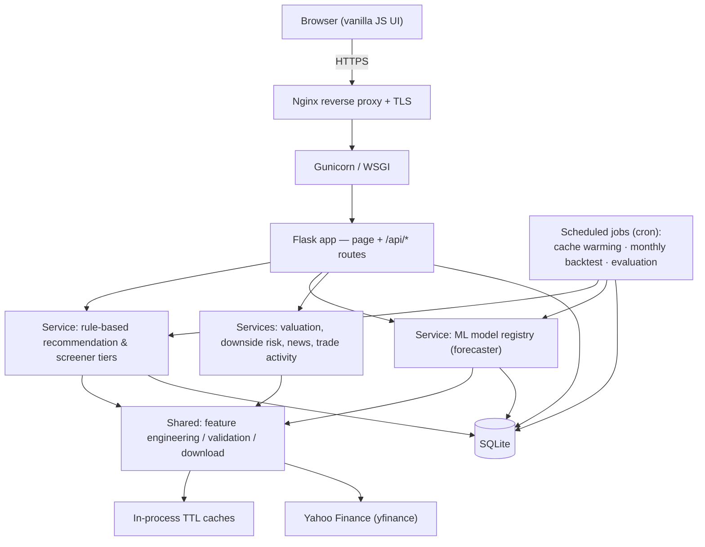

# RYCHEZT — Stock Forecasting & Screening Platform

A Flask web application that pairs a machine-learning 30-day return forecaster with a transparent, rule-based stock screener, served behind a production deployment with caching, scheduled cache warming, and a forward-testing backtest harness.

**Live app:** [zhyric.app](https://zhyric.app)

> **Note:** This is a public showcase repository documenting the architecture and engineering decisions. The application source is private (see [Status](#status)).

<!-- SCREENSHOTS: add 2–4 screenshots here (home / forecast view, recommendation tiers, backtest results) -->

---

## What it is

The platform contains **two distinct systems** that are intentionally kept separate in the codebase. They are easy to conflate, so to be precise:

**1. The 30-day return forecaster — this is the ML.**
A per-ticker XGBoost regressor that predicts a stock's forward 30-day return from engineered technical indicators. When a user requests a forecast for a symbol, a model is trained on that symbol's own price history and used to produce the prediction. This is the only machine-learning component.

**2. The recommendation / screener tiers — these are NOT ML.**
The Free, Premium, and Pro recommendation lists are produced by **deterministic, rule-based scoring**, not by any learned model. They combine fundamental and technical signals into a transparent point score, with a bounded news-sentiment adjustment layered on top. Every recommendation carries human-readable reasons explaining *why* it scored as it did. No neural network or trained estimator is involved in generating these lists.

These two systems share infrastructure (data download, caching, the ticker universe) but are independent: the screener does not call the ML models to rank stocks, and the forecaster does not depend on the screener. A reader should not assume the recommendation tiers are "AI-driven" — they are an explainable heuristic engine.

---

## Architecture

The application follows a layered separation:

- **Presentation** — server-rendered templates with vanilla JavaScript; no SPA framework.
- **Application / routing** — a Flask app factory exposing page routes and a set of `/api/*` JSON endpoints plus a `/predict` endpoint.
- **Service layer** — the business logic, split by responsibility: the ML model registry, the rule-based recommendation engine, the premium breakout/pre-breakout screener, valuation and downside-risk analysis, news sentiment, and public trade-activity signals. Recommendation *generation* is deliberately kept separate from *tier/access-control* logic.
- **Shared infrastructure** — reusable feature engineering, data download with validation/sanitization, and centralized configuration constants used across multiple models.
- **Data access** — a thin SQLite layer (schema, migrations, and cache tables).

### Data stores

- **SQLite** as the primary store: user accounts, preferences, watchlists, stored predictions and their realized outcomes, plus cache tables for fundamentals and recommendation payloads.
- **In-process TTL caches** for hot paths: a short-lived price-history download cache (so multiple models in one request, or a cron run, hit the data provider once) and longer-lived recommendation/premium caches with stale-fallback behavior.

### External integrations

- **Yahoo Finance (via `yfinance`)** is the single external data source — OHLCV price history, company fundamentals, news headlines, and insider/executive transaction data. The data layer is hardened against Yahoo's intermittent `401/429/5xx` responses, falling back to stale cached rows rather than failing a whole run.

<!-- VERIFY: insider/executive transactions are sourced from yfinance; "politician" trade signals are referenced in the code as a future/unimplemented source and are NOT live — confirm you want this omitted from the public README (it currently is). -->

### Deployment stack

Production runs on a **DigitalOcean Ubuntu droplet** with **Gunicorn** as the WSGI server (bound to localhost), **Nginx** as the reverse proxy handling public traffic, TLS, and static files, and **systemd** supervising the process. A **Docker Compose** configuration is also provided for containerized deployment, with Nginx + TLS (Certbot/Let's Encrypt) documented as the fronting layer.

<!-- VERIFY: there are two documented deployment paths and they differ. The native/droplet path (Gunicorn 127.0.0.1:8000 + Nginx + systemd) is described in DEPLOYMENT.md. The Docker image's CMD currently launches the app with `python app.py` (Flask's built-in server) on 127.0.0.1:5000, and `gunicorn` is NOT pinned in requirements.txt — the Docker guide describes Gunicorn/Nginx as the recommended fronting layer "when added." Confirm which path is actually live at zhyric.app and adjust the paragraph above so it matches reality. -->

### High-level request flow

---

## Technical highlights

Each item below is framed as **problem → approach → result**.

**Concurrent data fetching.**
*Problem:* scoring a list of stocks means many independent, latency-bound calls to Yahoo Finance, which is slow done sequentially.
*Approach:* fetches and per-ticker news analysis run on a `ThreadPoolExecutor` with up to **8 worker threads**, using `as_completed` so a single slow or failing ticker never blocks or aborts the batch.
*Result:* wall-clock time for a multi-ticker screen is bounded by the slowest few concurrent calls rather than the sum of all calls.
<!-- VERIFY: the code sets the worker pool to 8 (MAX_WORKERS = 8) and runs fetches concurrently, but there is NO measured speedup factor in the codebase or comments. Do not publish a specific "Nx faster" number unless you have benchmarked it; the claim above is deliberately qualitative. -->

**Forward-testing backtest harness.**
*Problem:* in-sample metrics on a held-out tail don't tell you whether predictions hold up in the real future.
*Approach:* a scheduled monthly job runs every registered model over the current top recommendations and stores each prediction. A separate evaluation job later fetches the *realized* price once the 30-day horizon has elapsed and records the actual return, direction correctness, and prediction error per stored prediction. Results are aggregated per model and per monthly batch (batch IDs are deterministic, giving idempotency).
*Result:* a growing record of genuine out-of-sample outcomes rather than only train-time metrics.

**Cache warming.**
*Problem:* generating recommendation tiers on a cold cache is expensive, so the first user after expiry would wait.
*Approach:* cron-driven warm-up scripts pre-compute and store the Free, Premium, and sector-specific payloads on a market-hours-aware cadence; the warm keys are constructed to match the keys the live routes read.
*Result:* user requests are typically served from a warm cache; stale-fallback keeps the UI responsive during data-provider outages.

**Resilience to a flaky upstream.**
*Problem:* Yahoo's public endpoints intermittently return `401/429/5xx`.
*Approach:* retries on the cron path, a short-TTL in-process download cache, and stale-cache fallback in the data layer so transient upstream failures degrade gracefully instead of failing whole runs.
*Result:* the screener and backtest remain usable through brief provider outages.

**Per-request model training (a deliberate design choice).**
*Problem:* a meaningful forecast needs a model fit to the specific ticker's history; there is no shared cross-sectional model.
*Approach:* rather than persisting model artifacts, each forecast request downloads fresh history, engineers features, trains the regressor on that ticker, evaluates on a held-out chronological tail, and predicts the latest row. Input price data is cached briefly to amortize repeated calls.
*Result:* always-current forecasts with no stale model artifacts to manage — at the cost of compute per request, which is an explicit and documented trade-off.

---

## Machine learning approach

This section describes the forecaster (system #1). It is written to be honest about both what is implemented and what is not.

**The prediction target.** A single regression target: a stock's forward 30-day return. Direction (bullish/bearish/neutral) and an estimated 30-day price are derived from that predicted return for display.

**Feature engineering.** Features are genuinely engineered from raw OHLCV data — not raw closing prices fed directly to the model. The base model uses **18 technical indicators** spanning several categories:

- lagged price returns over multiple lookbacks,
- moving-average ratios across several windows,
- rolling realized volatility,
- volume dynamics,
- intraday price spreads,
- price momentum,
- a relative-strength oscillator.

A market-aware variant extends this with broad-market context derived from a market-index ETF and a volatility index, plus a couple of stock-versus-market interaction features, for roughly **29 features** total. (Exact formulas are omitted here intentionally; this repo documents categories, not the implementation.) Feature computation includes explicit guards against zero-denominator / non-finite values, and the feature matrix is validated before it reaches the model.

**The model.** An **XGBoost gradient-boosted-tree regressor** (`xgboost`). Hyperparameters are currently a **fixed, hand-set configuration** (tree depth, learning rate, number of estimators, subsampling). They are **not** tuned via grid/random search or cross-validation — this is a known, deliberate "good defaults for now" state. The market-aware variants add early stopping against a small chronological validation slice carved from the end of the training data.

**Train/test split.** The split is **chronological**, not a random shuffle: the earliest ~80% of each ticker's samples are used for training and the most recent ~20% are held out for evaluation. This respects time ordering and avoids the most common form of look-ahead leakage in time-series ML. Minimum history, liquidity, and price thresholds are enforced before a model is trained at all.

**Embargo and baselines — what is NOT implemented.** To be candid:

- There is **no horizon-length embargo/purge gap** between the train and test segments. Because the target is a forward 30-day return, the labels of the last training rows are computed from prices that fall inside the test window, so there is a small, bounded boundary overlap. A proper 30-day embargo is not currently in place.
- There are **no naive baselines** (predict-zero, persistence/last-value, or train-mean) computed alongside the model, in either the per-request metrics or the backtest aggregation. Reported metrics (MAE, RMSE, R², direction accuracy) are therefore presented without a reference point, so they don't yet establish that the model beats a trivial predictor.

<!-- VERIFY: baselines/embargo not found in code. I searched the codebase for embargo/purge and for naive/persistence/train-mean baseline logic and found none in the model or evaluation paths. If you merge these later, update this section; do not claim them until then. -->

**Honest framing.** Predicting 30-day equity returns is genuinely hard, and a single per-ticker tree model on technical features is not expected to have large predictive power. The honest framing is intentional: the engineering value here is a clean, validated, leakage-aware-by-construction pipeline plus a real forward-testing harness — not a claim of market-beating accuracy. The most valuable next steps are exactly the candid gaps above: an embargo and naive baselines to contextualize the metrics, followed by hyperparameter tuning.

---

## Tech stack

- **Language:** Python
- **Web framework:** Flask (app-factory pattern), server-rendered templates + vanilla JavaScript frontend
- **Data / ML:** XGBoost, scikit-learn (metrics), pandas, NumPy
- **Market data:** yfinance (Yahoo Finance)
- **Datastore:** SQLite
- **Concurrency:** `concurrent.futures.ThreadPoolExecutor`
- **Server / infra:** Gunicorn, Nginx, systemd, Docker / Docker Compose, DigitalOcean (Ubuntu), Certbot/Let's Encrypt for TLS
- **Scheduling:** cron (cache warming, monthly backtest, evaluation)
- **Testing:** pytest

<!-- VERIFY: gunicorn is referenced in the deployment docs but is not pinned in requirements.txt (which lists Flask, numpy, pandas, scikit-learn, xgboost, yfinance). Confirm gunicorn is installed in the live environment before listing it as a hard dependency. -->

---

## Status

The application source is **private** while the project is being developed into a product. This repository documents the architecture and engineering decisions only; a full walkthrough or demo is available on request.
